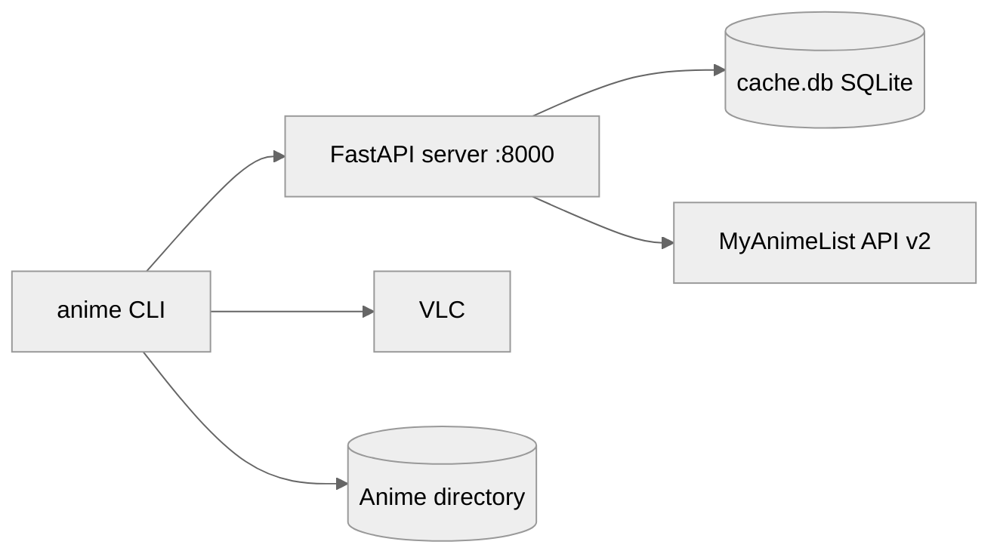

No Makefile, compose file or scripts exist. The CLI is started with `anime` (installed entry point) and the server manually with `uvicorn server.main:app` (uvicorn is not declared anywhere in the repository; this command is the standard way to run a FastAPI app). Both run in the foreground and stop with Ctrl+C.

## Prerequisites

Python 3.10+, VLC in PATH, optionally kitty terminal for cover images, tkinter for the file explorer dialogs, a MyAnimeList client id for the server.

## Setup (first run)

```bash
python -m venv .venv
source .venv/bin/activate
pip install -e .
pip install fastapi uvicorn   # server dependencies, not declared in pyproject.toml
echo "MAL_CLIENT_ID=<your client id>" > .env
```

## Topology



| Service | Role | Where it runs |
| ------- | ---- | ------------- |
| CLI | Terminal UI, playback, renaming | User machine |
| Server | Metadata proxy and cache | User machine, 127.0.0.1:8000 |

## Health Checks

| Service | Endpoint | Method | Expected response |
| ------- | -------- | ------ | ----------------- |
| server | / | GET | 200 `{"status": "ok"}` |

## Useful Commands

```bash
# Run the metadata server
uvicorn server.main:app --port 8000

# Run the CLI
anime

# Point the CLI at another metadata server (env var wins over config.json)
ANIME_API_URL=http://nas.local:8000 anime

# Run tests
pip install -e ".[dev]"
pytest
anime --rename /path/to/series

# Build
python -m build
```

## External Integrations

| Service | Purpose | Authentication |
| ------- | ------- | -------------- |
| MyAnimeList API v2 | Anime search and details | `X-MAL-CLIENT-ID` header |

## Troubleshooting

| Symptom | Likely cause | Fix |
| ------- | ------------ | --- |
| KeyError MAL_CLIENT_ID on server start | Missing env var | Set it in `.env` or the environment |
| Connection refused in CLI when fetching info | Server not running, or wrong server URL | Start `uvicorn server.main:app`, or check `ANIME_API_URL` / `api_url` in `config.json` |
| `Invalid server URL ... (from ANIME_API_URL)` or `Invalid config file ...` on start | Bad URL (needs http:// or https://, host, valid port, no credentials) or malformed `config.json` | Fix or unset the value; the CLI never edits `config.json` |
| "VLC is not installed or is not in PATH" | VLC missing | Install VLC |
| No cover image | Not running in kitty or terminal too narrow | Use kitty, widen terminal |
